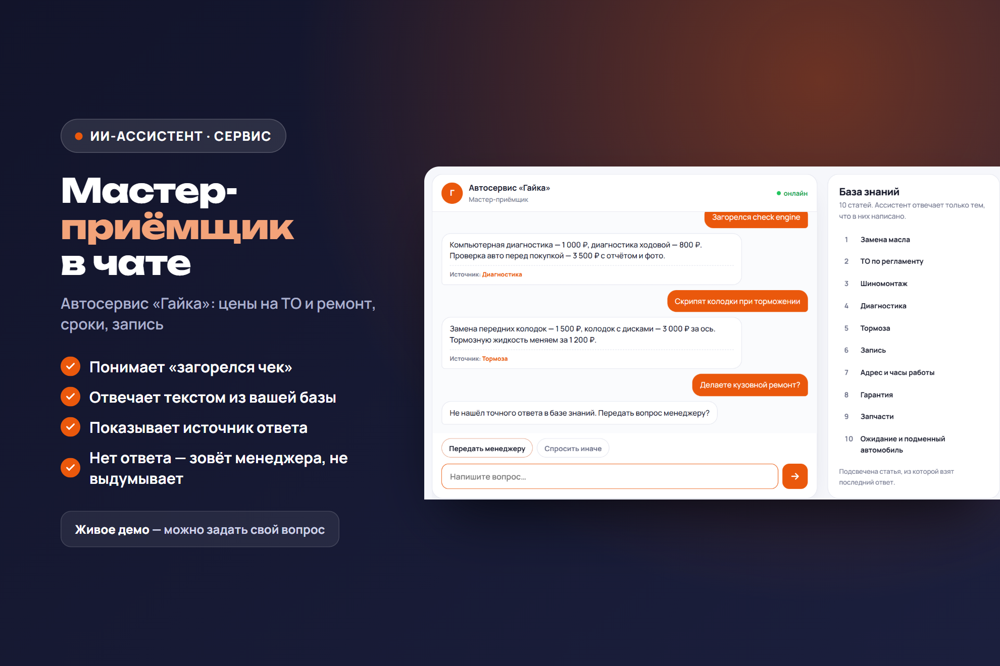

# Ассистенты по базе знаний

Онлайн-ассистенты для сайта или внутреннего портала: отвечают клиентам и сотрудникам по базе знаний компании, показывают источник ответа и честно предлагают менеджера, если ответа в базе нет.

**[Открыть демо](https://grozeser.github.io/ai-assistants-demo/)** — четыре ассистента, можно задать свой вопрос.



| Ассистент | База знаний |
|---|---|
| Стоматология «Жемчуг» | цены, запись, лечение, гарантии, налоговый вычет — 11 статей |
| Магазин «Лён и хлопок» | доставка, размеры, возврат, оплата, уход — 10 статей |
| Автосервис «Гайка» | ТО, шиномонтаж, диагностика, тормоза, запись — 10 статей |
| HR-помощник «Вектор» | отпуск, больничный, зарплата, ДМС, справки — 10 статей |

## Как это работает

Без нейросети и без сервера — всё в браузере ([assistant.js](assistant.js), ~150 строк):

1. Вопрос разбирается на основы слов: «доставка», «доставки», «доставкой» → одно слово. Синонимы приводятся к словам базы: «почём» → «цена», «загорелся чек» → «диагностика».
2. Статьи сравниваются с вопросом по TF-IDF: редкие слова («имплант», «колодки») весят больше частых.
3. Если совпадение уверенное — ответ берётся из статьи дословно, с подписью «Источник». Если нет — ассистент предлагает передать вопрос менеджеру.

База знаний — обычный JSON ([kb/](kb/)): заголовок, несколько формулировок вопроса и ответ. Её легко заполнить из FAQ, прайса или регламента.

## Точность

```bash
node tests/accuracy.cjs
```

| Набор | Результат |
|---|---|
| Вопросы, на которых настраивались синонимы и порог | 48 из 50 (96%) |
| Отложенные вопросы, написанные после настройки | 15 из 20 (75%) |

Типичные промахи — вопросы на стыке двух статей («отпуск на испытательном сроке») и вопросы не по теме, у которых есть общее слово с базой («обувь 38 размера» → статья про размеры). Поэтому у каждого ответа виден источник и есть кнопка «Не то? Позвать менеджера». Для сложных баз ответы может формулировать нейросеть (GigaChat, YandexGPT, OpenAI) — поиск по базе остаётся тем же.

`node tests/ui.cjs` прогоняет диалоги в браузере (Playwright) и снимает скриншоты для `docs/`.

## Запуск

Откройте через любой статический сервер (базы загружаются через `fetch`):

```bash
python -m http.server 8000
```

Компании и данные вымышленные. Заявки менеджеру в демо никуда не отправляются.
